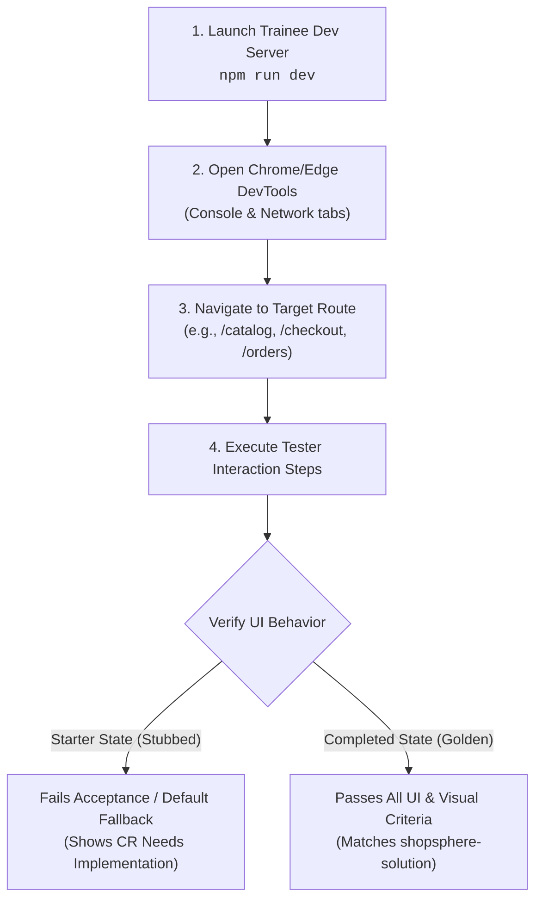

# ShopSphere — Change Request (CR) UI Verification & Tester Guide

**Target Environment Under Test**: `c:\Users\DELL\Downloads\SHOPSPHERE\shopsphere-trainee` (Local Dev: `http://localhost:5173` or `http://localhost:3000`)  
**Golden Reference Baseline**: `c:\Users\DELL\Downloads\SHOPSPHERE\shopsphere-solution` (Golden Dev: `http://localhost:3000`)  
**Audience**: Quality Assurance (QA) Testers, Curriculum Mentors, Code Reviewers, and Trainees  
**Document Purpose**: Comprehensive manual test matrix detailing the exact user interactions, observable visual states, and console/network behavior across all 38 Change Requests. Use this guide to contrast **Trainee Starter Behavior** (unimplemented/stubbed) against **Expected Solution Behavior** (completed golden implementation).

---

## 1. Quick-Start Test Execution Protocol



### Dual-Window Testing Setup:
1. **Window 1 (Trainee Under Test)**: Run `npm run dev` in `shopsphere-trainee`. Note the port (e.g. `http://localhost:5173`).
2. **Window 2 (Golden Reference)**: Run `npm run dev` in `shopsphere-solution` on port `http://localhost:3000`.
3. Perform the exact interaction steps below in both windows to immediately observe the functional delta.

---

## 2. Master Verification Matrix by Batch & Sub-Topic

```
===================================================================================
BATCH 1: Foundations, Design Tokens & Reusable UI Primitives (CR-02A to CR-04B)
===================================================================================
```

### [CR-02A] Multi-Currency Union Types & Pure Conversion Utilities
- **Target URL**: `/catalog` or `/products/1`
- **User Action**: Click the Currency selector dropdown in the top right of the navigation header. Switch from `USD ($)` to `EUR (€)`, `GBP (£)`, or `JPY (¥)`.
- **Trainee Starter Behavior (Stubbed)**:
  - Prices remain displayed strictly in USD (e.g. `$109.95`), or currency symbols change but the numeric price does not calculate with exchange rates (stays `109.95 €` instead of `101.15 €`).
- **Expected Solution Behavior (Golden Baseline)**:
  - All product card prices, detail page prices, and cart badges dynamically recalculate across all views using live rates:
    - USD `$100.00` converts to EUR `€92.00`
    - USD `$100.00` converts to GBP `£79.00`
    - USD `$100.00` converts to JPY `¥15,500`
  - Decimal values format cleanly to 2 decimal places with proper currency symbols.

---

### [CR-02B] Generic Record DTOs & Runtime Configuration Types
- **Target URL**: `/` (Homepage) & Footer
- **User Action**: Inspect the platform footer and feature badge banner at the bottom of the page. Open browser DevTools console.
- **Trainee Starter Behavior (Stubbed)**:
  - Platform flags (e.g. `features.enableVipConcierge`, `api.timeoutMs`) default to hardcoded unverified values without runtime type guards or configuration validation logging.
- **Expected Solution Behavior (Golden Baseline)**:
  - The runtime configuration object is frozen and strictly typed (`AppConfig`), exposing feature flags and active environment values without runtime exceptions.

---

### [CR-03A] Parent-to-Child Props Flow & Multi-Level Catalog Hierarchy
- **Target URL**: `/catalog`
- **User Action**: Hover over any product card in the catalog grid and observe the quick action overlay. Click the "Quick View" eye button.
- **Trainee Starter Behavior (Stubbed)**:
  - Clicking "Quick View" fails to bubble up to `ProductListPage`, or clicks are swallowed because the callback prop `onQuickView` is unhandled or not wired down to child cards.
- **Expected Solution Behavior (Golden Baseline)**:
  - Clicking "Quick View" immediately invokes `onQuickView(product)`, opening the luxury Quick View modal with the clicked product's details, image, and options.

---

### [CR-03B] Reusable Star Rating & Review Badge Component Library
- **Target URL**: `/catalog` and `/products/1`
- **User Action**: Inspect the rating area on any product card and under the main product title on the product detail page.
- **Trainee Starter Behavior (Stubbed)**:
  - Star ratings render as plain unstyled text (e.g. `"Rating: 4.5/5"`) or raw numbers without SVG star icons or filled/empty star states.
- **Expected Solution Behavior (Golden Baseline)**:
  - Beautiful gold SVG stars render with precise fractional/half-star fills (e.g., 4 filled stars + 1 half star for 4.5).
  - Hovering over interactive stars (in review forms) highlights them dynamically with smooth transition colors.
  - Review badges display pill-shaped counts: `★ 4.8 (124 reviews)`.

---

### [CR-04A] Luxury Dark Mode & Dynamic CSS Theme Tokens
- **Target URL**: Global (`/`, `/catalog`, `/cart`, etc.)
- **User Action**: Click the Sun/Moon theme toggle icon in the top navigation bar. Refresh the browser page.
- **Trainee Starter Behavior (Stubbed)**:
  - Clicking the toggle does not update the `data-theme` attribute on `<html>` or `<body>`. Background remains permanently light atelier white. Refreshing the browser resets the theme.
- **Expected Solution Behavior (Golden Baseline)**:
  - Clicking the toggle instantly transitions the app to "Midnight Noir" dark mode:
    - Background shifts to deep obsidian noir (`#09090b` / `#121214`).
    - Surface cards transition to charcoal glassmorphism.
    - Typography transitions to crisp atelier white (`#f4f4f5`).
  - Reloading the page retains the chosen theme via `localStorage.getItem('shopsphere-theme')`.

---

### [CR-04B] Dual-Mode Catalog List/Grid Rendering & Responsive ProductRow
- **Target URL**: `/catalog`
- **User Action**: Locate the layout view switcher icon buttons (Grid icon vs List icon) right above the product grid on the right side. Click the **List View** button.
- **Trainee Starter Behavior (Stubbed)**:
  - Clicking the List View icon either has no effect (stays in 3-column grid) or renders broken table markup.
- **Expected Solution Behavior (Golden Baseline)**:
  - The catalog smoothly rearranges into horizontal full-width editorial cards (`ProductListRow`):
    - Left: Large product thumbnail with quick-action badges.
    - Center: Editorial brand eyebrow, title, full description snippet, and star badge.
    - Right: Dynamic price, stock indicator, and "Add to Bag" / "Quick View" action buttons.
  - Clicking **Grid View** reverts back to the standard 3-column masonry grid.

---

```
===================================================================================
BATCH 2: Interactive State, Complex Forms & Custom Hooks (CR-05A to CR-07C)
===================================================================================
```

### [CR-05A] Customer Order Lifecycle State Machine & Cancellation Flow
- **Target URL**: `/orders`
- **User Action**: Log in as a customer, navigate to My Orders. Find an order with status `"Confirmed"`. Click the red **"Cancel Order"** button. Confirm the dialog prompt.
- **Trainee Starter Behavior (Stubbed)**:
  - Clicking "Cancel Order" does not trigger state machine transition; order status remains `"Confirmed"`, or clicking the button throws an unhandled state mutation error.
- **Expected Solution Behavior (Golden Baseline)**:
  - A modal confirms: *"Are you sure you wish to cancel Order #ORD-XXXX?"*.
  - Upon confirming, order state immutably transitions to `"Cancelled"`.
  - The status pill turns from gold `"Confirmed"` to muted charcoal/red `"Cancelled"`.
  - The "Cancel Order" button disappears and is replaced by a disabled `"Order Cancelled"` badge.
  - A success toast notification appears: *"Order successfully cancelled"*.

---

### [CR-05B] Shared Pricing Calculation Engine & Financial Breakdown State
- **Target URL**: `/cart` & `/checkout`
- **User Action**: Add products to cart so that the subtotal exceeds `$500.00`. Open `/cart` or `/checkout`. Observe the Order Summary sidebar.
- **Trainee Starter Behavior (Stubbed)**:
  - Volume discount displays `$0.00` (`Standard Member - 0%`).
  - Tax displays `$0.00` or raw unrounded floating-point numbers.
  - Shipping cost does not calculate free shipping over `$150.00`.
- **Expected Solution Behavior (Golden Baseline)**:
  - Order Summary displays an itemized financial breakdown:
    - **VIP Tier**: `"Atelier Connoisseur (15% VIP)"`
    - **Volume Discount**: Exact 15% discount subtracted (e.g. `-$75.00` on `$500.00`).
    - **Estimated Sales Tax**: Exact 8.25% applied on net subtotal.
    - **Delivery Fee**: `$0.00 (Complimentary VIP Delivery)` with free delivery qualification pill.
    - **Grand Total**: Perfectly rounded to 2 decimal places.

---

### [CR-06A] Controlled Product Review Form & Field-Level Validation
- **Target URL**: `/products/1` (Scroll down to "Client Reviews" section)
- **User Action**: Leave headline and commentary blank. Click **"Submit Client Review"**.
- **Trainee Starter Behavior (Stubbed)**:
  - The form submits without validation, or browser throws an error, or empty reviews are appended to the list.
- **Expected Solution Behavior (Golden Baseline)**:
  - Form submission is prevented (`e.preventDefault()`).
  - Distinct inline error messages render in red below each invalid input:
    - Headline: *"Headline must be at least 5 characters"*.
    - Commentary: *"Commentary must be at least 20 characters"*.
  - When valid data is typed (e.g. rating 5, headline: `"Exquisite Cashmere Weave"`, commentary: `"The tailoring and fabric weight exceed all expectations for winter wear."`), clicking Submit immediately appends the new review to the list and resets the form inputs cleanly.

---

### [CR-06B] Checkout Payment Validation with Luhn Algorithm & Card Formatting
- **Target URL**: `/checkout` (Payment Step)
- **User Action**: In the Card Number field, type `4111 1111 1111 1111` (invalid Luhn test number) or type letters. Type an invalid expiry `13/20` or expired date `01/22`.
- **Trainee Starter Behavior (Stubbed)**:
  - Input accepts arbitrary characters, does not auto-format spaces every 4 digits, accepts expired dates, or submits without validating the card checksum.
- **Expected Solution Behavior (Golden Baseline)**:
  - **Auto-Formatting**: Card number auto-inserts spaces every 4 digits: `XXXX XXXX XXXX XXXX`.
  - **Luhn Algorithm Check**: Real-time checksum flags invalid numbers with: *"Invalid credit card number checksum"*.
  - **Expiry Validation**: Rejects months > 12 or past years: *"Card expiration must be in the future (MM/YY)"*.
  - **CVV Validation**: Enforces strict 3 or 4 digits.
  - Place Order button is disabled until all payment fields are valid.

---

### [CR-06C] Reusable Controlled Form Element Primitives & Error Summaries
- **Target URL**: `/checkout` & `/account`
- **User Action**: Inspect input components when invalid. Tab through fields without entering values.
- **Trainee Starter Behavior (Stubbed)**:
  - Raw inputs without `aria-invalid` or accessible error labels; errors rendered as plain divs without IDs linking to inputs via `aria-describedby`.
- **Expected Solution Behavior (Golden Baseline)**:
  - Accessible controlled `<Input />` components with red focus rings, warning icons, and assistive screen reader linkage (`aria-invalid="true"`).

---

### [CR-07A] Custom Hook: useCountdownTimer with Interval Cleanup
- **Target URL**: `/` (Homepage Top Banner) or `/catalog`
- **User Action**: Observe the "Private Atelier Flash Sale" countdown banner at the top of the page (`Ends in: HH:MM:SS`). Navigate away to `/cart` and back to `/`.
- **Trainee Starter Behavior (Stubbed)**:
  - Timer is static (`00:00:00`), or interval leaks in background causing multiple timers to fire rapidly and increment CPU usage.
- **Expected Solution Behavior (Golden Baseline)**:
  - Seconds decrement smoothly every 1,000ms (`04:59:59` -> `04:59:58`).
  - When navigating between pages, `useEffect` cleanup hook calls `clearInterval`, preventing React memory leak warnings in console.

---

### [CR-07B] Custom Hook: useFocusTrap for Modal Keyboard Accessibility
- **Target URL**: `/catalog` (Open any Quick View Modal) or `/` (Open Concierge Modal)
- **User Action**: Open the modal. Press the keyboard `Tab` key repeatedly, then press `Shift + Tab`.
- **Trainee Starter Behavior (Stubbed)**:
  - Focus escapes the modal and highlights background page links, buttons in Navbar, and invisible DOM nodes behind the backdrop.
- **Expected Solution Behavior (Golden Baseline)**:
  - Focus is strictly trapped inside the modal container.
  - Tabbing through the last focusable element wraps focus back to the first element (Close button).
  - `Shift + Tab` backwards from the first element wraps to the last interactive element.

---

### [CR-07C] Custom Hook: useDebounce for Search Input Optimization
- **Target URL**: `/catalog`
- **User Action**: Rapidly type `"leather jacket"` in the search input while watching the Network / Console tab.
- **Trainee Starter Behavior (Stubbed)**:
  - Filter updates on every single keystroke (14 re-renders and re-computations in 1 second), causing typing lag.
- **Expected Solution Behavior (Golden Baseline)**:
  - Catalog filtering waits until 300ms after the user stops typing before recomputing results. Smooth 60fps typing experience.

---

```
===================================================================================
BATCH 3: Routing, API Mutations & Global Store (CR-08A to CR-10B)
===================================================================================
```

### [CR-08A] Order Status Filter Route & Query Parameter Synchronization
- **Target URL**: `/orders`
- **User Action**: Click the `"Cancelled"` filter tab. Observe the browser URL bar. Copy the URL (`http://localhost:3000/orders?status=cancelled`), open a new browser tab, and paste the URL.
- **Trainee Starter Behavior (Stubbed)**:
  - Clicking tabs does not change the URL (stays `/orders`). Pasting the URL resets the filter back to `"All Orders"`.
- **Expected Solution Behavior (Golden Baseline)**:
  - URL updates to `/orders?status=cancelled` in real time via `useSearchParams`.
  - Direct deep linking or browser Refresh keeps the `"Cancelled"` tab active and only shows cancelled orders.
  - Browser Back button navigates to the previous filter state.

---

### [CR-08B] Protected & Public Route Guards with Return Path Redirection
- **Target URL**: Directly navigate to `http://localhost:3000/account` or `/checkout` while logged out.
- **User Action**: Enter the URL while logged out.
- **Trainee Starter Behavior (Stubbed)**:
  - Page shows a blank screen, throws an unauthenticated runtime error, or redirects to `/login` without preserving where the user wanted to go.
- **Expected Solution Behavior (Golden Baseline)**:
  - Automatically redirects to `/login?redirect=%2Faccount` or `/login?redirect=%2Fcheckout`.
  - After logging in, the user is immediately redirected back to their intended target page instead of being dumped on the homepage.

---

### [CR-08C] Reusable Application Shell & Layout System (RootLayout)
- **Target URL**: Any route (`/`, `/catalog`, `/cart`, `/orders`, `/account`)
- **User Action**: Inspect page structure across different pages.
- **Trainee Starter Behavior (Stubbed)**:
  - Repetitive Navbar and Footer markup declared on every page component, causing Navbar to unmount/remount on navigation.
- **Expected Solution Behavior (Golden Baseline)**:
  - Seamless React Router `<Outlet />` nested inside `<RootLayout />`. Navigation bar maintains state without flickering or unmounting during route transitions.

---

### [CR-09A] Axios HTTP Client with Interceptors, Bearer Auth & Fallback Resilience
- **Target URL**: Open DevTools Network tab on `/catalog`
- **User Action**: Inspect API calls to `/products`. In DevTools, set Network Throttling to **"Offline"** and refresh.
- **Trainee Starter Behavior (Stubbed)**:
  - Raw `fetch` without interceptors; offline mode shows a blank screen with uncaught network error.
- **Expected Solution Behavior (Golden Baseline)**:
  - Centralized Axios client attaches Bearer token if logged in.
  - On network failure or offline mode, interceptor gracefully catches the error and serves mock catalog fallback data without crashing the UI.

---

### [CR-09B] Admin Batch Category Price Adjustment & TanStack Mutation Cache
- **Target URL**: `/admin` (Log in with admin account)
- **User Action**: Select Category: `"Jewelery"`. Enter Adjustment: `+10%`. Click **"Apply Price Adjustment"**. Navigate to `/catalog`.
- **Trainee Starter Behavior (Stubbed)**:
  - Clicking button has no effect, or prices update only in local component state and revert when navigating to the catalog.
- **Expected Solution Behavior (Golden Baseline)**:
  - TanStack Query mutation fires with optimistic UI update.
  - Cache invalidation triggers on query key `['products']`.
  - All jewelry products immediately reflect the 10% price increase on both `/admin` table and `/catalog` customer storefront.

---

### [CR-09C] Typed API Response Models & DTO Normalization Layer
- **Target URL**: `/catalog`
- **User Action**: Inspect product cards for products with irregular API response fields (e.g. missing ratings or non-standard price formats).
- **Trainee Starter Behavior (Stubbed)**:
  - Products with missing rating object crash with `TypeError: Cannot read properties of undefined (reading 'rate')`.
- **Expected Solution Behavior (Golden Baseline)**:
  - Normalization layer intercepts raw JSON and fills default safe fallbacks (`rating: { rate: 0, count: 0 }`), ensuring 100% crash-free rendering.

---

### [CR-10A] Redux Preferences Slice for Multi-Currency & Active Locale
- **Target URL**: Global (`/`, `/catalog`, `/cart`)
- **User Action**: Switch currency from USD to JPY in Navbar. Add an item to cart. Open `/cart` and `/checkout`.
- **Trainee Starter Behavior (Stubbed)**:
  - Currency switch only affects the current page; cart page reverts to USD or breaks because global store lacks a preferences slice.
- **Expected Solution Behavior (Golden Baseline)**:
  - Redux Toolkit `preferencesSlice` broadcasts the selected currency across all routes.
  - Catalog, Cart, Checkout, and Confirmation pages all display synchronized JPY `¥` values.

---

### [CR-10B] Redux Toolkit Toast Notification Feed & Auto-Dismiss Dispatcher
- **Target URL**: Global
- **User Action**: Click **"Add to Bag"** on 3 products in rapid succession.
- **Trainee Starter Behavior (Stubbed)**:
  - Alert messages pop up as native browser `window.alert()`, or toasts overlap each other and never auto-dismiss.
- **Expected Solution Behavior (Golden Baseline)**:
  - Sleek luxury toast cards stack gracefully in the top-right corner.
  - Each toast displays a gold progress bar and auto-dismisses after 4,000ms, or can be dismissed manually with the `X` button.

---

```
===================================================================================
BATCH 4: Enterprise Security, Portals & Performance (CR-11A to CR-13B)
===================================================================================
```

### [CR-11A] Customer Profile Security & Password Update Validation Guard
- **Target URL**: `/account` (Security Tab)
- **User Action**: Attempt to update password entering: Current Password: `wrong`, New Password: `abc`, Confirm Password: `xyz`.
- **Trainee Starter Behavior (Stubbed)**:
  - Form allows submission without validating current password, or accepts weak 3-letter passwords.
- **Expected Solution Behavior (Golden Baseline)**:
  - Validation requires minimum 8 characters, at least 1 uppercase letter, 1 number, and 1 special character.
  - Highlights password mismatch: *"Passwords do not match"*.
  - Disables Save button until complexity criteria are satisfied.

---

### [CR-11B] Session Token Expiration Interceptor & Graceful Re-Authentication
- **Target URL**: DevTools Application Tab -> `localStorage` -> edit `shopsphere-token` to `"expired-token"`.
- **User Action**: Click any authenticated action (e.g. View Orders or Update Profile).
- **Trainee Starter Behavior (Stubbed)**:
  - App enters an infinite loop, or throws an unhandled 401 error leaving user stuck on a broken page.
- **Expected Solution Behavior (Golden Baseline)**:
  - Axios response interceptor catches the 401 Unauthorized.
  - Clears stale session tokens from `localStorage`.
  - Shows warning toast: *"Your luxury session has expired. Please log in again."*.
  - Gracefully redirects to `/login`.

---

### [CR-11C] Client-Side Security Sanitization (XSS Stripping & Card Masking)
- **Target URL**: `/products/1` (Review Form) & `/account` (Saved Cards)
- **User Action**: In the Review Headline, type `<script>alert('XSS')</script>Luxury Watch`. Check saved card display.
- **Trainee Starter Behavior (Stubbed)**:
  - Raw script tags are rendered into the DOM or saved in storage; card numbers display all 16 digits in clear text.
- **Expected Solution Behavior (Golden Baseline)**:
  - Script tags and HTML entities are stripped clean: `"Luxury Watch"`.
  - Card numbers are masked securely: `•••• •••• •••• 4242`.

---

### [CR-12A] Accessible createPortal Quick View Modal with Backdrop Blur
- **Target URL**: `/catalog`
- **User Action**: Click "Quick View" on any product card. Inspect the DOM in DevTools Elements tab. Press `Escape` key.
- **Trainee Starter Behavior (Stubbed)**:
  - Modal is rendered inline inside the product card `<div>` (causing CSS z-index and overflow clipping issues). Pressing `Escape` does not close the modal.
- **Expected Solution Behavior (Golden Baseline)**:
  - Modal is rendered via `ReactDOM.createPortal` directly into `document.body`.
  - Screen has a luxury glassmorphism backdrop blur.
  - Pressing `Escape` key or clicking outside the modal content dismisses the modal cleanly.
  - Body scrolling is locked (`overflow: hidden`) while the modal is open.

---

### [CR-12B] Compound Dialog Pattern: Modal.Header, Modal.Body, Modal.Footer
- **Target URL**: Code inspection of `<Modal>` usage in Quick View and Concierge Modals.
- **User Action**: Inspect component markup.
- **Trainee Starter Behavior (Stubbed)**:
  - Monolithic modal taking 10 arbitrary props (`headerText`, `bodyText`, `footerButtonText`, etc.).
- **Expected Solution Behavior (Golden Baseline)**:
  - Clean compound component pattern:
    ```tsx
    <Modal isOpen={isOpen} onClose={onClose}>
      <Modal.Header>Title</Modal.Header>
      <Modal.Body>Content</Modal.Body>
      <Modal.Footer><Button>Action</Button></Modal.Footer>
    </Modal>
    ```

---

### [CR-12C] Generic Table Primitive with Type-Safe Column Definitions
- **Target URL**: `/admin` (Product Management Table)
- **User Action**: Inspect the inventory table in the admin dashboard. Sort columns by Price or Title.
- **Trainee Starter Behavior (Stubbed)**:
  - Hardcoded table markup using `any` types for table rows; non-reusable.
- **Expected Solution Behavior (Golden Baseline)**:
  - Generic `<GenericTable<Product> columns={columns} data={products} />` with type-safe accessors and column headers.

---

### [CR-13A] Memoized Catalog Computations with useMemo for Price & Category Analytics
- **Target URL**: `/catalog`
- **User Action**: Select category `"women's clothing"`. Move the Price Slider to `$50`. Type `"cotton"` in the search input.
- **Trainee Starter Behavior (Stubbed)**:
  - Filters do not filter products (starter stub returns all products), or un-memoized recalculations freeze the UI.
- **Expected Solution Behavior (Golden Baseline)**:
  - The catalog filters instantaneously to products matching category AND price <= $50 AND search query.
  - The results count badge updates: `"Showing 3 items"`.
  - Memoized with `useMemo`, preventing expensive re-filtering when unrelated state updates.

---

### [CR-13B] Stable Callback References with useCallback & Virtualized Scroll
- **Target URL**: `/catalog`
- **User Action**: Rapidly scroll through the catalog.
- **Trainee Starter Behavior (Stubbed)**:
  - Child card components re-render on every scroll tick because handler functions are re-created on every render.
- **Expected Solution Behavior (Golden Baseline)**:
  - Stable callback references wrapped in `useCallback` prevent unnecessary child card re-renders.

---

```
===================================================================================
BATCH 5: Enterprise Quality, A11y & Capstone Experience (CR-14A to CR-17B)
===================================================================================
```

### [CR-14A] Vitest Unit Tests for Pricing Calculation Engine
- **Target URL**: Terminal command: `npm test src/test/pricingEngine.test.ts`
- **User Action**: Run the test command in terminal.
- **Trainee Starter Behavior (Stubbed)**:
  - Tests **fail** (e.g. `AssertionError: expected +0 to be 5`), confirming the student has not implemented the math yet.
- **Expected Solution Behavior (Golden Baseline)**:
  - All 5 test suites pass cleanly with 100% assertions:
    - Tiered discount threshold verification.
    - Sales tax calculation.
    - Free delivery qualification.
    - Promotional coupon codes (`ATELIER20`, `VIP50`).

---

### [CR-14B] Component Interaction Tests for Form Validation
- **Target URL**: Terminal command: `npm test src/test/Button.test.tsx` and review form tests.
- **User Action**: Run component test suite.
- **Trainee Starter Behavior (Stubbed)**:
  - Component tests fail or have missing assertions for invalid field states.
- **Expected Solution Behavior (Golden Baseline)**:
  - Full interaction tests verify button click dispatch, form validation banners, and disabled button states using `@testing-library/react`.

---

### [CR-14C] Service Mocking & Route Guard Integration Tests
- **Target URL**: Terminal command: `npm test src/test/ProtectedRoute.test.tsx`
- **User Action**: Run route guard test suite.
- **Trainee Starter Behavior (Stubbed)**:
  - Route tests fail or unhandled redirects fail without mocking `AuthContext`.
- **Expected Solution Behavior (Golden Baseline)**:
  - Clean test suites pass with mocked authenticated vs unauthenticated contexts.

---

### [CR-15A] Enterprise Structured Logger & Custom Exception Hierarchy
- **Target URL**: Open browser DevTools Console
- **User Action**: Trigger an action (e.g. Add to Cart or Place Order). Inspect console logs.
- **Trainee Starter Behavior (Stubbed)**:
  - Raw unformatted `console.log()` calls scattered across files, or no structured logging metadata.
- **Expected Solution Behavior (Golden Baseline)**:
  - Standardized JSON structured logs formatted with timestamps, log levels (`[INFO]`, `[WARN]`, `[ERROR]`), action name, and metadata payloads:
    ```json
    {"timestamp":"2026-10-16T10:45:00Z","level":"INFO","event":"CART_ITEM_ADDED","payload":{"productId":1,"quantity":1}}
    ```

---

### [CR-15B] Centralized Runtime Configuration & Vite Environment Boundaries
- **Target URL**: Global
- **User Action**: Inspect `appConfig.ts` and environment variables.
- **Trainee Starter Behavior (Stubbed)**:
  - Direct calls to `import.meta.env` littered in components without fallback defaults.
- **Expected Solution Behavior (Golden Baseline)**:
  - Single centralized configuration singleton with schema validation and default fallbacks for missing env keys.

---

### [CR-15C] WCAG 2.1 AA Accessible Live Announcer Region
- **Target URL**: Inspect DOM body: `<div aria-live="polite" id="live-announcer">`
- **User Action**: Add a product to cart or apply a filter.
- **Trainee Starter Behavior (Stubbed)**:
  - No `aria-live` container exists. Screen readers are not notified of dynamic catalog updates or cart modifications.
- **Expected Solution Behavior (Golden Baseline)**:
  - An invisible polite live region (`aria-live="polite"`, `role="status"`) announces changes:
    *"Fjallraven Backpack added to shopping bag. Total items: 1."*

---

### [CR-17A] VIP Concierge Consultation Inquiry Workflow & Bespoke Modal
- **Target URL**: Navigation Bar -> Click **"Bespoke Concierge"** button
- **User Action**: Click the button in the header. Fill in the consultation form (Client Name, Email, Preferred Service: Styling, Requested Date, Notes). Submit.
- **Trainee Starter Behavior (Stubbed)**:
  - Button does not open the modal, or the modal form is missing, or submission does not save the consultation appointment.
- **Expected Solution Behavior (Golden Baseline)**:
  - A luxury bespoke consultation modal opens with date picker and service selectors.
  - Form validates required fields and submits cleanly.
  - Confirmation toast appears: *"Concierge request received. A private stylist will contact you within 2 hours."*.

---

### [CR-17B] Interactive Multi-Stage Order Delivery Milestone Progress Timeline
- **Target URL**: `/orders` -> View any order details card
- **User Action**: Inspect the order status section of an existing order.
- **Trainee Starter Behavior (Stubbed)**:
  - Order status is displayed as plain text without an interactive milestone stepper.
- **Expected Solution Behavior (Golden Baseline)**:
  - An interactive 4-stage visual timeline stepper:
    `Order Placed` ➔ `Atelier Packaging` ➔ `Dispatched via Courier` ➔ `Delivered to Residence`
  - Active and completed stages show gold checkmarks and pulsing progress rings.
  - Future stages appear in clean muted grey.

---

## 3. Comprehensive Tester Sign-Off Checklist

| Batch | CR ID | Feature Name | Trainee Status (Before) | Golden Status (After) | QA Verified |
| :---: | :---: | :--- | :---: | :---: | :---: |
| **B1** | `CR-02A` | Multi-Currency Conversion | ❌ Stays in USD | ✅ Real-time EUR/GBP/JPY | [ ] |
| **B1** | `CR-02B` | Generic Record DTOs & Config | ❌ Unverified flags | ✅ Typed AppConfig | [ ] |
| **B1** | `CR-03A` | Parent-to-Child Props Flow | ❌ Unhandled callbacks | ✅ Quick View bubbles up | [ ] |
| **B1** | `CR-03B` | Star Rating & Review Badge | ❌ Plain unstyled text | ✅ Gold SVG Stars & Badges | [ ] |
| **B1** | `CR-04A` | Dark Mode CSS Theme Tokens | ❌ Fixed light mode | ✅ Midnight Noir toggle | [ ] |
| **B1** | `CR-04B` | Dual-Mode List/Grid Catalog | ❌ Grid only | ✅ List Row & Grid switcher | [ ] |
| **B2** | `CR-05A` | Order Lifecycle Cancellation | ❌ Read-only orders | ✅ State machine cancel | [ ] |
| **B2** | `CR-05B` | Shared Pricing Engine & VIP Tiers | ❌ $0 discount stub | ✅ 15% VIP, Tax, Shipping | [ ] |
| **B2** | `CR-06A` | Review Form Validation | ❌ Submits empty data | ✅ Field error banners | [ ] |
| **B2** | `CR-06B` | Checkout Luhn Card Validation | ❌ Unformatted card | ✅ Luhn check & format | [ ] |
| **B2** | `CR-06C` | Accessible Form Primitives | ❌ Raw inputs | ✅ aria-invalid & styled | [ ] |
| **B2** | `CR-07A` | Countdown Timer Hook | ❌ Static time / leaks | ✅ 1s interval & cleanup | [ ] |
| **B2** | `CR-07B` | Focus Trap Modal Hook | ❌ Focus escapes modal | ✅ Tab strictly trapped | [ ] |
| **B2** | `CR-07C` | useDebounce Search Hook | ❌ Re-renders every key | ✅ 300ms smooth debounce | [ ] |
| **B3** | `CR-08A` | Order Filter URL Sync | ❌ Tabs don't change URL | ✅ /orders?status=cancelled | [ ] |
| **B3** | `CR-08B` | Protected Route Guards | ❌ Blank / crashes | ✅ Login redirect with return | [ ] |
| **B3** | `CR-08C` | Reusable App Shell & Layout | ❌ Remounts Navbar | ✅ Seamless RootLayout | [ ] |
| **B3** | `CR-09A` | Axios Interceptors & Fallback | ❌ Raw fetch | ✅ Bearer auth & offline mock | [ ] |
| **B3** | `CR-09B` | Admin Price Mutation & Cache | ❌ Local state only | ✅ TanStack mutation sync | [ ] |
| **B3** | `CR-09C` | API Response Normalization | ❌ Undefined errors | ✅ Safe DTO fallback models | [ ] |
| **B3** | `CR-10A` | Redux Preferences Slice | ❌ Route-isolated state | ✅ Global currency sync | [ ] |
| **B3** | `CR-10B` | Redux Toast Notification Feed | ❌ window.alert() | ✅ Animated toast stack | [ ] |
| **B4** | `CR-11A` | Profile Password Security Guard | ❌ Weak passwords | ✅ Complexity validation | [ ] |
| **B4** | `CR-11B` | Session Expiration Interceptor | ❌ Infinite loop | ✅ Auto-clears & redirects | [ ] |
| **B4** | `CR-11C` | Client XSS & Card Masking | ❌ Raw HTML & cleartext | ✅ Strips XSS & masks cards | [ ] |
| **B4** | `CR-12A` | createPortal Quick View Modal | ❌ Inline clipped div | ✅ document.body portal | [ ] |
| **B4** | `CR-12B` | Compound Dialog Pattern | ❌ 10-prop monolith | ✅ Modal.Header/Body/Footer | [ ] |
| **B4** | `CR-12C` | Generic Table Primitive | ❌ Hardcoded any table | ✅ GenericTable<T> | [ ] |
| **B4** | `CR-13A` | useMemo Catalog Computations | ❌ Pipeline disabled | ✅ Instant memoized filter | [ ] |
| **B4** | `CR-13B` | useCallback & Stable Handlers | ❌ Excessive re-renders | ✅ 60fps stable callbacks | [ ] |
| **B5** | `CR-14A` | Pricing Engine Vitest Suite | ❌ 3 tests fail | ✅ 5/5 tests pass | [ ] |
| **B5** | `CR-14B` | Form Interaction Tests | ❌ Missing assertions | ✅ Form RTL tests pass | [ ] |
| **B5** | `CR-14C` | Service Mocking Tests | ❌ Missing context mocks| ✅ Guard tests pass | [ ] |
| **B5** | `CR-15A` | Enterprise Structured Logger | ❌ console.log() | ✅ Standardized JSON logs | [ ] |
| **B5** | `CR-15B` | Centralized Runtime Config | ❌ Scattered env calls | ✅ Validated config singleton| [ ] |
| **B5** | `CR-15C` | WCAG 2.1 Live Announcer | ❌ Missing aria-live | ✅ aria-live="polite" active | [ ] |
| **B5** | `CR-17A` | VIP Concierge Consultation Modal | ❌ No modal flow | ✅ Consultation booking | [ ] |
| **B5** | `CR-17B` | Multi-Stage Delivery Timeline | ❌ Plain text status | ✅ 4-stage visual stepper | [ ] |

---

## 4. How to Conduct QA Review for a Single Trainee CR

When a student submits their implementation for any given Change Request (e.g. **CR-05B**):
1. **Pull the trainee's branch**:
   ```bash
   cd c:\Users\DELL\Downloads\SHOPSPHERE\shopsphere-trainee
   ```
2. **Execute Static Analysis & Tests**:
   ```bash
   npx tsc --noEmit
   npm test src/test/pricingEngine.test.ts
   ```
3. **Perform UI Walkthrough**:
   - Follow the **User Action** in Section 2 for that CR.
   - Verify that the UI transitions from the **Trainee Starter Behavior** to the **Expected Solution Behavior**.
4. **Sign Off**:
   - Check off the CR in the **Sign-Off Checklist** (Section 3).
