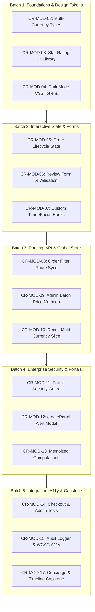

# ShopSphere — Change Request (CR) Injection Master Plan for Trainee

**Target Workspace**: `c:\Users\DELL\Downloads\SHOPSPHERE\shopsphere-trainee`  
**Reference Golden Baseline**: `c:\Users\DELL\Downloads\SHOPSPHERE\shopsphere-solution`  
**Governance Framework**: Modular Curriculum-Aligned Change Requests (15 Total Modules)  
**Standard Quality Bar**: Zero `any` TypeScript, 100% Vitest pass rate, WCAG 2.1 AA accessibility  

---

## 1. Pedagogical Architecture & Principles

The ShopSphere training program simulates a real-world enterprise engineering team. Instead of building toy apps from scratch or fixing contrived bugs, trainees work directly on an enterprise-grade luxury e-commerce platform (**ShopSphere**).

### Core Training Principles:
1. **Net-New Feature Progression**: Every CR introduces genuine business capability (e.g. multi-currency pricing, VIP concierge booking, interactive review forms). Zero artificial defects are injected.
2. **100% Independence**: Each CR can be developed and tested in isolation directly on the baseline without blocking on other CRs.
3. **Reference Golden Baseline**: The trainee can always compare their code and test outcomes against [`shopsphere-solution`](file:///c:/Users/DELL/Downloads/SHOPSPHERE/shopsphere-solution).
4. **Automated Quality Verification**: Every CR requires passing TypeScript type checks (`tsc --noEmit`), unit/integration tests (`npm test`), and production bundling (`npm run build`).

---

## 2. Progressive CR Injection Roadmap (5 Phased Batches)



---

### Batch 1: Foundational TypeScript & Reusable Primitives (Modules 2–4)
*Focus: Type systems, component prop contracts, dynamic CSS custom properties.*

| CR ID | Title & Module | Target Files | Key Learning Objectives | Est. Effort |
| :---: | :--- | :--- | :--- | :---: |
| [**CR-MOD-02**](file:///c:/Users/DELL/Downloads/SHOPSPHERE/shopsphere-trainee/change-requests/CR-MOD-02/request.md) | **Multi-Currency Union Types & Generic Record DTOs** (Module 2) | `src/types/currency.ts`<br>`src/utils/currencyUtils.ts` | • Union types (`USD \| EUR \| GBP \| JPY`)<br>• Generic mapping (`Record<CurrencyCode, number>`)<br>• Type narrowing & pure conversion functions | 2–3 hrs |
| [**CR-MOD-03**](file:///c:/Users/DELL/Downloads/SHOPSPHERE/shopsphere-trainee/change-requests/CR-MOD-03/request.md) | **Reusable Star Rating & Review Badge Component Library** (Module 3) | `src/components/ui/StarRating.tsx`<br>`src/components/ui/StarRating.css`<br>`src/components/ui/ReviewBadge.tsx` | • Functional component prop typing<br>• Optional props with default values<br>• Accessible ARIA attributes & event handlers | 2–3 hrs |
| [**CR-MOD-04**](file:///c:/Users/DELL/Downloads/SHOPSPHERE/shopsphere-trainee/change-requests/CR-MOD-04/request.md) | **Luxury Dark Mode & Dynamic CSS Theme Tokens** (Module 4) | `src/styles/index.css`<br>`src/components/common/ThemeToggle.tsx`<br>`src/layouts/Navbar.tsx` | • CSS Custom Properties (`--bg-primary`, etc.)<br>• Dynamic DOM attribute toggling (`data-theme`)<br>• `localStorage` persistence and smooth transitions | 2–3 hrs |

---

### Batch 2: Interactive State & Complex Forms (Modules 5–7)
*Focus: State machine transitions, controlled inputs, custom hooks lifecycle.*

| CR ID | Title & Module | Target Files | Key Learning Objectives | Est. Effort |
| :---: | :--- | :--- | :--- | :---: |
| [**CR-MOD-05**](file:///c:/Users/DELL/Downloads/SHOPSPHERE/shopsphere-trainee/change-requests/CR-MOD-05/request.md) | **Customer Order Lifecycle State Machine & Cancellation** (Module 5) | `src/pages/OrdersPage.tsx`<br>`src/services/orderService.ts` | • Immutable array updates without mutation<br>• Finite state transitions (`Confirmed -> Cancelled`)<br>• Confirmation modal & status toast feedback | 3–4 hrs |
| [**CR-MOD-06**](file:///c:/Users/DELL/Downloads/SHOPSPHERE/shopsphere-trainee/change-requests/CR-MOD-06/request.md) | **Controlled Product Review Form & Field-Level Validation** (Module 6) | `src/features/reviews/ReviewForm.tsx`<br>`src/features/reviews/ReviewList.tsx`<br>`src/pages/ProductDetailPage.tsx` | • Controlled inputs with `React.FormEvent`<br>• Field-level validation (rating, headline, commentary)<br>• Optimistic review rendering and session persistence | 3–4 hrs |
| [**CR-MOD-07**](file:///c:/Users/DELL/Downloads/SHOPSPHERE/shopsphere-trainee/change-requests/CR-MOD-07/request.md) | **Custom Hooks: `useCountdownTimer` & `useFocusTrap`** (Module 7) | `src/hooks/useCountdownTimer.ts`<br>`src/hooks/useFocusTrap.ts` | • `useEffect` interval cleanup & memory leak prevention<br>• `useRef` DOM trapping for keyboard Tab navigation<br>• Generic, reusable hook interface design | 2–3 hrs |

---

### Batch 3: Routing, API Mutations & Global Store (Modules 8–10)
*Focus: URL query synchronization, TanStack Query cache invalidation, Redux Toolkit slices.*

| CR ID | Title & Module | Target Files | Key Learning Objectives | Est. Effort |
| :---: | :--- | :--- | :--- | :---: |
| [**CR-MOD-08**](file:///c:/Users/DELL/Downloads/SHOPSPHERE/shopsphere-trainee/change-requests/CR-MOD-08/request.md) | **Order Status Filter Route & Query Param Synchronization** (Module 8) | `src/pages/OrdersPage.tsx` | • React Router `useSearchParams` synchronization<br>• Deep-linkable filter tabs (`/orders?status=cancelled`)<br>• Browser back/forward navigation preservation | 2–3 hrs |
| [**CR-MOD-09**](file:///c:/Users/DELL/Downloads/SHOPSPHERE/shopsphere-trainee/change-requests/CR-MOD-09/request.md) | **Admin Batch Category Price Adjustment & Mutation Cache** (Module 9) | `src/pages/AdminPage.tsx`<br>`src/hooks/useCatalog.ts`<br>`src/services/apiService.ts` | • TanStack Query `useMutation` hook<br>• Cache invalidation on key `['products']`<br>• Real-time table and storefront synchronization | 3–4 hrs |
| [**CR-MOD-10**](file:///c:/Users/DELL/Downloads/SHOPSPHERE/shopsphere-trainee/change-requests/CR-MOD-10/request.md) | **Redux Preferences Slice for Multi-Currency & Locale** (Module 10) | `src/store/slices/preferencesSlice.ts`<br>`src/layouts/Navbar.tsx`<br>`src/utils/formatters.ts` | • Redux Toolkit `createSlice`, typed actions & selectors<br>• Header currency dropdown triggering global store<br>• Synchronized price conversion across all views | 2–3 hrs |

---

### Batch 4: Enterprise Security, Portals & Performance (Modules 11–13)
*Focus: Auth guards, session validation, DOM portals, memoization & render optimization.*

| CR ID | Title & Module | Target Files | Key Learning Objectives | Est. Effort |
| :---: | :--- | :--- | :--- | :---: |
| [**CR-MOD-11**](file:///c:/Users/DELL/Downloads/SHOPSPHERE/shopsphere-trainee/change-requests/CR-MOD-11/request.md) | **Customer Profile Security & Session Invalidation Guard** (Module 11) | `src/pages/AccountPage.tsx`<br>`src/context/AuthContext.tsx` | • Role-based access validation<br>• Password confirmation & format enforcement<br>• Token expiration interceptor & graceful login redirect | 2–3 hrs |
| [**CR-MOD-12**](file:///c:/Users/DELL/Downloads/SHOPSPHERE/shopsphere-trainee/change-requests/CR-MOD-12/request.md) | **`createPortal` Stock Alert Modal & Compound Dialog** (Module 12) | `src/components/catalog/StockNotificationModal.tsx`<br>`src/pages/ProductDetailPage.tsx` | • `ReactDOM.createPortal` rendering to `document.body`<br>• Compound component pattern (`Modal.Header`, `Modal.Body`)<br>• Keyboard Escape dismissal & backdrop blur | 2–3 hrs |
| [**CR-MOD-13**](file:///c:/Users/DELL/Downloads/SHOPSPHERE/shopsphere-trainee/change-requests/CR-MOD-13/request.md) | **Memoized Catalog Computations & Virtualized Inventory Scroll** (Module 13) | `src/pages/ProductListPage.tsx`<br>`src/pages/AdminPage.tsx` | • Profiling unnecessary re-renders<br>• `useMemo` for price distributions & category counts<br>• `useCallback` for stable event handler references | 2–3 hrs |

---

### Batch 5: Integration Testing, Accessibility & Capstone (Modules 14–17)
*Focus: End-to-end integration tests, WCAG live announcements, luxury multi-stage workflows.*

| CR ID | Title & Module | Target Files | Key Learning Objectives | Est. Effort |
| :---: | :--- | :--- | :--- | :---: |
| [**CR-MOD-14**](file:///c:/Users/DELL/Downloads/SHOPSPHERE/shopsphere-trainee/change-requests/CR-MOD-14/request.md) | **Automated Integration Tests for Checkout & Admin CRUD** (Module 14) | `src/test/CheckoutForm.test.tsx`<br>`src/test/AdminCrud.test.tsx` | • Component testing with `@testing-library/react`<br>• Mocking user typing and submission (`@testing-library/user-event`)<br>• Edge-case testing: invalid card rejection, item deletion | 3–4 hrs |
| [**CR-MOD-15**](file:///c:/Users/DELL/Downloads/SHOPSPHERE/shopsphere-trainee/change-requests/CR-MOD-15/request.md) | **Centralized Audit Logger & WCAG Live Announcer** (Module 15) | `src/services/auditLogger.ts`<br>`src/components/common/LiveAnnouncer.tsx`<br>`src/App.tsx` | • Singleton service architecture for client-side audit trails<br>• Accessible live regions (`aria-live="polite"`, `aria-atomic="true"`)<br>• Screen reader notifications on asynchronous actions | 2–3 hrs |
| [**CR-MOD-17**](file:///c:/Users/DELL/Downloads/SHOPSPHERE/shopsphere-trainee/change-requests/CR-MOD-17/request.md) | **VIP Concierge Consultation & Order Milestone Tracking** (Module 17) | `src/features/concierge/ConciergeModal.tsx`<br>`src/components/orders/OrderTimeline.tsx`<br>`src/pages/OrderConfirmationPage.tsx` | • Capstone multi-stage user journey<br>• Multi-step delivery progress bar (Confirmed &rarr; Delivered)<br>• Bespoke VIP luxury booking integration | 3–4 hrs |

---

## 3. Trainee Implementation Workflow

For each assigned CR, the trainee follows a standardized 5-step engineering discipline:

```text
[1. Read Spec]           [2. Implement Code]          [3. Write Tests]          [4. Quality Gate]          [5. Code Review]
change-requests/         src/components/...           src/test/...              tsc --noEmit               Compare with
CR-MOD-XX/request.md     src/types/...                src/utils/...             npm test                   shopsphere-solution
acceptance-criteria.md   src/hooks/...                                          npm run build              Baseline
```

### Quality Gate Checklist before Submission:
- [ ] **Type Safety**: `npx tsc --noEmit` passes with **0 errors** (strict mode, zero `any`).
- [ ] **Automated Tests**: `npm test -- --run` passes **100% of test suites**.
- [ ] **Production Build**: `npm run build` succeeds without warnings or bundle failures.
- [ ] **Accessibility**: Interactive elements are keyboard navigable (`Tab`, `Escape`) with visible focus outlines and screen-reader accessible attributes.
- [ ] **No Regression**: Storefront browsing, cart operations, checkout flow, and admin portal remain fully operational.

---

## 4. Master Specification Index

All detailed specifications are located directly within the trainee repository:
- Master Tabular Matrix: [`cto-cr-review-matrix.md`](file:///c:/Users/DELL/Downloads/SHOPSPHERE/shopsphere-trainee/change-requests/cto-cr-review-matrix.md)
- Complete CR Catalogue: [`cr-catalogue.md`](file:///c:/Users/DELL/Downloads/SHOPSPHERE/shopsphere-trainee/change-requests/cr-catalogue.md)
- Curriculum Coverage Map: [`curriculum-coverage.md`](file:///c:/Users/DELL/Downloads/SHOPSPHERE/shopsphere-trainee/change-requests/curriculum-coverage.md)
- Missing Functionality Inventory: [`missing-functionality-inventory.md`](file:///c:/Users/DELL/Downloads/SHOPSPHERE/shopsphere-trainee/change-requests/missing-functionality-inventory.md)
- Approval Register: [`approval-register.md`](file:///c:/Users/DELL/Downloads/SHOPSPHERE/shopsphere-trainee/change-requests/approval-register.md)
