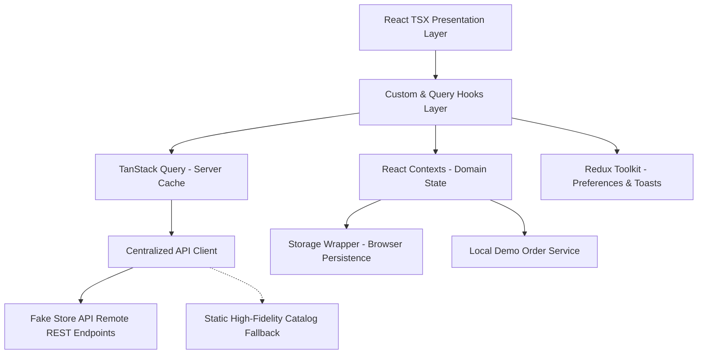

# ShopSphere — Architecture Specification

## 1. High-Level Architecture Overview

ShopSphere is structured around clean domain separation, feature boundaries, and resilient state layering. The architecture purposefully decouples remote data fetching, domain state machines, display preferences, and presentation components.



---

## 2. Layered Organization & Directory Boundaries

The source codebase follows enterprise frontend conventions under `src/`:

```
src/
├── components/          # Reusable UI primitives & cross-cutting components
│   ├── common/          # Error boundaries, toast container, HOCs
│   └── ui/              # Button, Input, Select, Modal, GenericTable, Accordion
├── context/             # Domain state machines (CartContext, WishlistContext, AuthContext)
├── features/            # Feature-specific components, cards, and skeletons
│   └── catalog/         # ProductCard, ProductSkeleton
├── hooks/               # Custom hooks (useCatalog, useDebounce, useDocumentTitle)
├── layouts/             # RootLayout, Navbar, Footer, ProtectedRoute
├── pages/               # Route components (Home, Catalog, ProductDetail, Cart, etc.)
├── services/            # API client layer, mock data fallbacks, demo order service
├── store/               # Redux Toolkit store, typed hooks, preferences slice
├── styles/              # Design tokens, typography, CSS resets, global rules
├── types/               # Domain interfaces, enums, utility types, discriminated unions
└── utils/               # Formatters, cart calculations, storage wrappers
```

---

## 3. State Management Strategy & Selection Matrix

ShopSphere intentionally avoids monolithic global state by matching each type of data to its optimal state mechanism:

| Data Type | State Solution | Rationale & Responsibility |
| :--- | :--- | :--- |
| **Server Catalog Data** | **TanStack Query** | Products and categories have distinct caching lifetimes (`staleTime: 5m`). Query keys ensure granular cache invalidation and background refetching without polluting client stores. |
| **Shopping Cart** | **Context + `useReducer`** | State transitions (`ADD_ITEM`, `REMOVE_ITEM`, `UPDATE_QUANTITY`, `CLEAR_CART`) require complex atomic mutations and derived total calculations. Managed by a discriminated action union reducer with localStorage hydration. |
| **Wishlist** | **Context API** | Simple collection of saved items persisted to browser storage. Supports direct "Move to Bag" cross-context delegation. |
| **Authentication Session** | **AuthContext** | Holds current demo JWT token, user profile, role discrimination (`'customer'` vs `'admin'`), and token expiration checks. |
| **Display Preferences & Notifications** | **Redux Toolkit** | Store configuration (`configureStore`, `createSlice`) manages currency formatting preferences, items-per-page thresholds, and the asynchronous queue of transient toast notifications (`useAppDispatch`, `useAppSelector`). |
| **Form Inputs & Filters** | **Local State / URL Params** | Form fields use local controlled state. Filter parameters (category, search, sort) sync to `useSearchParams` for bookmarkability and back/forward browser support. |
| **Simulated Orders** | **OrderService** | Encapsulated local storage service recording simulated order receipts with full timestamp and status tracking. |

---

## 4. Resilience and Error Recovery

1. **Network Fault Tolerance**: The API layer catches fetch errors, abort timeouts, and rate limits. When remote connectivity is interrupted, it transparently returns cached high-fidelity fallback data to prevent blank screens.
2. **Storage Recovery**: The `getStorageItem` wrapper verifies JSON parsing and falls back cleanly if stored browser keys contain invalid or corrupt data.
3. **Component Fault Isolation**: An enterprise React `ErrorBoundary` wraps major routes, rendering graceful fallback cards with a "Try Again" recovery action.
4. **Duplicate Submission Protection**: The multi-step checkout workflow locks the final submission button (`isSubmitting` guard) to prevent accidental double-ordering.
